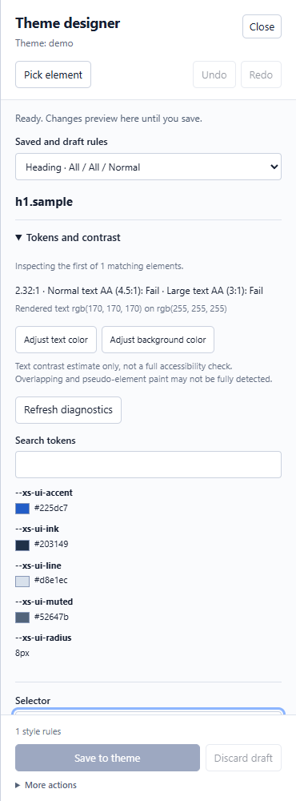
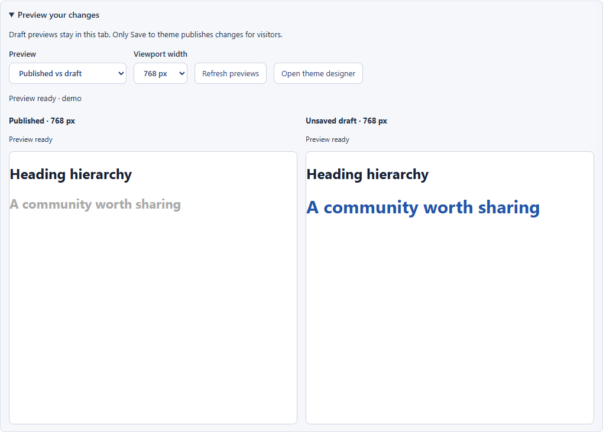
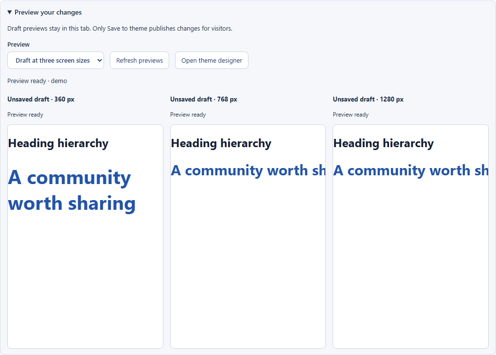

# Improve your XOOPS theme with cssHolmes and xStyles

**Inspect an example, adjust its styles, compare the result, then publish when ready.**

xStyles puts common headings, tables, forms and other page elements in one
gallery. cssHolmes adds inspection and visual editing. Together, they give you
a repeatable place to improve a theme without hunting through different pages
or rewriting its original stylesheets.

## Before you start

Install or update both modules, then open **xStyles → Go to module** to reach
the frontend gallery. Log in as a cssHolmes module administrator, or use an
account with **Overlay** and **Edit** permissions. Publishing also requires
**Workbench** permission. These instructions cover frontend themes.

The screenshots below show the actual designer and preview controls with an
isolated demonstration example. Your theme supplies the appearance of the
examples; its fonts and colors will differ.

## 1. Inspect an example

Choose **Typography** in xStyles and select a heading example. Click
**Inspect example** to open cssHolmes with its first relevant element selected
and **Tokens and contrast** expanded. Use **Pick element** to choose another
element within the example.

Check the **Selector** and matching-element count: a rule may affect several
elements on real pages. Prefer a reusable theme selector over a gallery-only ID.
For a low measured contrast ratio, **Adjust text color** or **Adjust background
color** takes you to the corresponding editing control.

*Inspect the selected element before deciding what to change. Contrast readings
are estimates; they do not certify the whole theme's accessibility.*

## 2. Edit and compare before publishing

Click **Edit styles**, or continue in the open designer. Try changing the
heading's **Font size**, for example from `22px` to `30px`, and **Text color**
from pale gray to `#2255aa`.

Expand **Preview your changes** and select **Published vs draft**. Both panes
show the same example and theme at the same viewport width. The published pane
keeps the saved appearance; the draft pane follows your edits. **Undo**, **Redo**
and **Discard draft** let you try alternatives before deciding.

*Compare a proposed change with the published result without switching tabs or publishing each experiment.*

## 3. Check three screen sizes together

Choose **Draft at three screen sizes** to preview **360, 768 and 1280 CSS pixels**.
Use each pane's scrollbars to explore wider content. In the designer, choose a
screen-size scope when a change should apply only to mobile, tablet or desktop.

*Here the mobile draft uses 40px while the wider drafts retain 30px. The different
sizes illustrate scoped editing; choose values that suit your own design.*

These private draft panes belong to **Preview your changes**. The ordinary
xStyles **Compare themes** and **Responsive preview** panels show published
styles only.

## 4. Publish deliberately—and reuse good work

When satisfied, click **Save to theme**. This publishes the overrides for the
selected theme and can change what visitors see. The private panes refresh after
saving. Check a representative real page as well as the gallery.

To keep an alternative for later, save a **named set** in the designer's library.
Saving a set does **not** publish it. See [Theme sets](theme-sets.md) for reuse,
import and export.

Drafts stay in the current page until saved. Closing the designer retains the
draft there; navigating away loses unsaved changes. Saved overrides live outside
the theme's source files and require cssHolmes to remain active, unless you
export and integrate the CSS yourself.

## Why this makes theme work more productive

| Task | What the combined workflow saves |
|---|---|
| Find a useful test page | xStyles gathers common elements in one searchable gallery. |
| Locate and adjust a style | Inspect/Edit connects the example directly to the designer. |
| Judge an experiment | Published and draft panes show the difference together. |
| Check responsive behavior | Three widths update from the same draft. |
| Reuse a successful design | Named sets preserve alternatives without publishing them. |

For example, you can inspect a heading, adjust its size and color, compare the
saved appearance, check three widths, and publish once—all from the same page.
The benefit is fewer repeated navigation, resize and save cycles, rather than
an unmeasured promise of a particular speed increase.

For more controls and recovery options, read the [visual designer guide](visual-designer.md).
